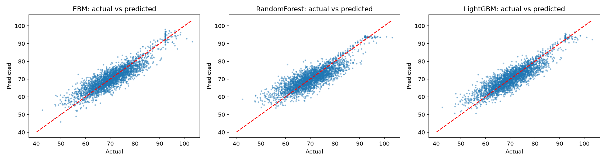
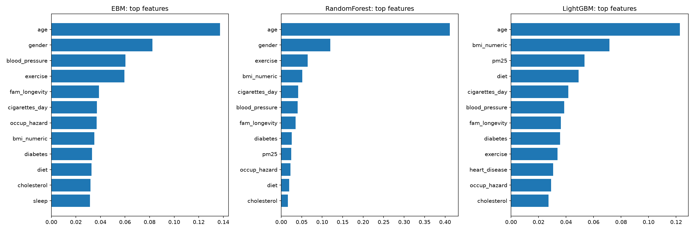

# Sri Lanka Life Expectancy Explorer

An interactive machine learning dashboard for exploring how health and lifestyle factors relate to **simulated age of death** in a synthetic Sri Lankan cohort. Enter a profile to get an estimate, inspect the model explanation, and compare model performance in one place.

> **For learning and demonstration only.** The project uses synthetic data. Predictions are not medical advice and are not real life expectancy estimates.

<!-- Add a screenshot of the frontend here (for example, save it as docs/frontend-screenshot.png). -->


## What’s inside

- **Frontend:** React 18, TypeScript, Vite, and Recharts. The dashboard includes a prediction form, model comparison, and visual summaries.
- **Backend:** Python and FastAPI serve the trained models and dashboard data through a small JSON API.
- **Machine learning:** Explainable Boosting Machine (EBM) is the primary model, compared with Random Forest and LightGBM. The training pipeline uses preprocessing, a validation-based EBM parameter search, and train/validation/test splits.
- **Interpretability and evaluation:** EBM feature contributions, feature importance, partial dependence, group error summaries, and standard regression metrics (MAE, RMSE, and R²). SHAP is also used to create a LightGBM summary plot during training.
- **Data:** The training script downloads the synthetic Sri Lankan health cohort from Kaggle using `kagglehub`.

## Model training results

The models were trained on a 150,000-row sample of the synthetic cohort using a 70%/15%/15% train/validation/test split. The results below are from the held-out test set generated by the current training run. The target is `simulated_age_of_death`, so the error values are measured in years.

| Model | MAE (years) | RMSE (years) | R² | Training time |
| --- | ---: | ---: | ---: | ---: |
| **EBM** (primary explainable model) | 2.916 | 3.681 | 0.7877 | 34.7 s |
| Random Forest | 3.269 | 4.166 | 0.7281 | 106.0 s |
| **LightGBM** (best RMSE) | 2.897 | 3.677 | 0.7881 | 3.6 s |

LightGBM achieved the lowest test RMSE, while EBM provides the dashboard's main interpretable predictions and feature-level explanations. Across the models, `age` was the strongest feature, followed by factors such as gender, blood pressure, exercise, family longevity, and smoking-related variables.

### Generated training plots

Actual-versus-predicted values for all three models:



Normalized feature importance comparisons:



SHAP summary for the LightGBM benchmark:


## Prerequisites

- Python 3.10 or newer
- Node.js 18 or newer and npm
- Internet access for the training script to download the dataset

## Run the project

Use two terminals from the project root: one for the API and one for the dashboard. The first run also needs model training; it downloads the dataset and writes model files and evaluation artifacts to `backend/artifacts/`.

### 1. Train the models and start the backend

From the project root, create and activate a virtual environment and install the backend dependencies:

```powershell
cd backend
python -m venv .venv
.\.venv\Scripts\Activate.ps1
python -m pip install --upgrade pip
pip install -r requirements.txt
```

#### Train or retrain the models

URL for the dataset - https://www.kaggle.com/datasets/bawanthabeliwaththa/sri-lankan-health-data-from-various-factors

Run the training script from the `backend/` directory:

```powershell
python train.py
```

The script downloads the synthetic dataset from Kaggle on its first run, prepares the features, tunes the EBM settings on a validation split, and trains EBM, Random Forest, and LightGBM models. It evaluates them on a held-out test split and writes the trained models, feature schema, evaluation metrics, holdout example, and plots to `backend/artifacts/`. Training can take a while. Rerun `python train.py` whenever you want to regenerate these artifacts; keep the API stopped while retraining.

After training succeeds, start the API from the same `backend/` directory:

```powershell
uvicorn main:app --reload --port 8000
```

The API is available at <http://localhost:8000>; interactive API documentation is at <http://localhost:8000/docs>.

### 2. Start the frontend

In a second terminal, from the project root:

```powershell
cd frontend
npm install
npm run dev
```

Open the Vite URL shown in the terminal (typically <http://localhost:5173>). The frontend connects to the API at `http://localhost:8000` by default. To use another API URL, create `frontend/.env.local` with:

```env
VITE_API_URL=http://localhost:8000
```

## API endpoints

| Method | Endpoint | Purpose |
| --- | --- | --- |
| `GET` | `/health` | API status and loaded models |
| `GET` | `/schema` | Feature names, valid values, and numeric ranges |
| `GET` | `/metrics` | Model scores, feature importance, partial dependence, and group error summaries |
| `GET` | `/holdout` | A held-out sample profile for the dashboard demo |
| `POST` | `/predict` | Generate a prediction for the supplied features and optional model |

## Project layout

```text
health-ml/
├── backend/
│   ├── train.py          # Download data, train models, and build artifacts
│   ├── main.py           # FastAPI application
│   ├── requirements.txt  # Python dependencies
│   └── artifacts/        # Generated models, schema, metrics, and plots
└── frontend/
    ├── src/              # React dashboard and API client
    └── package.json      # Frontend scripts and dependencies
```

## Build the frontend

To create a production build:

```powershell
cd frontend
npm run build
```

The compiled files are written to `frontend/dist/`.
